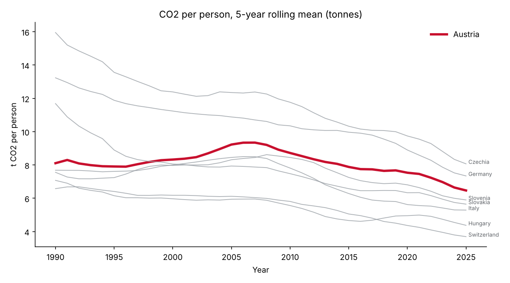
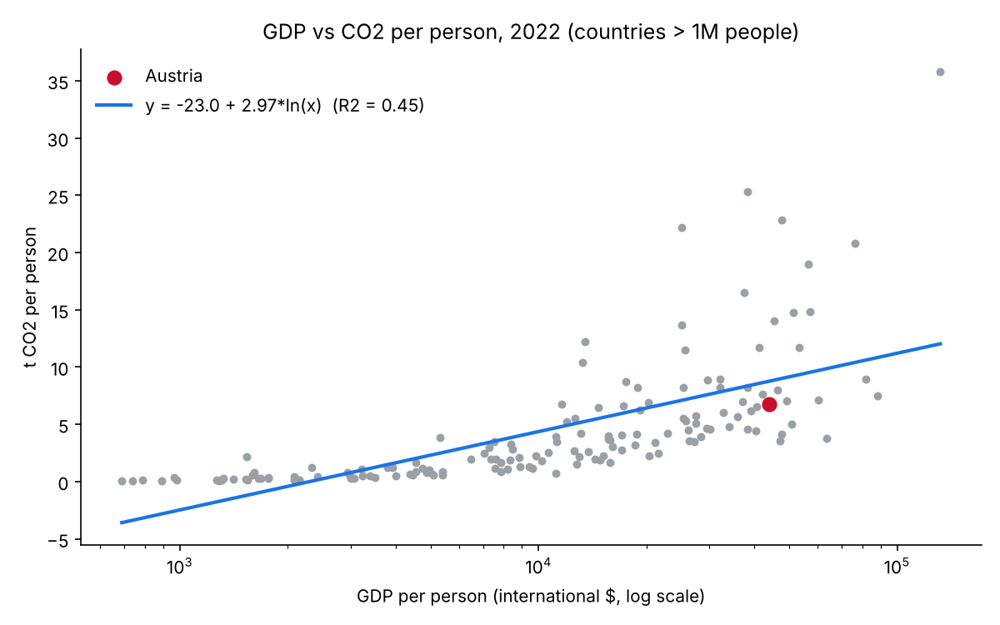
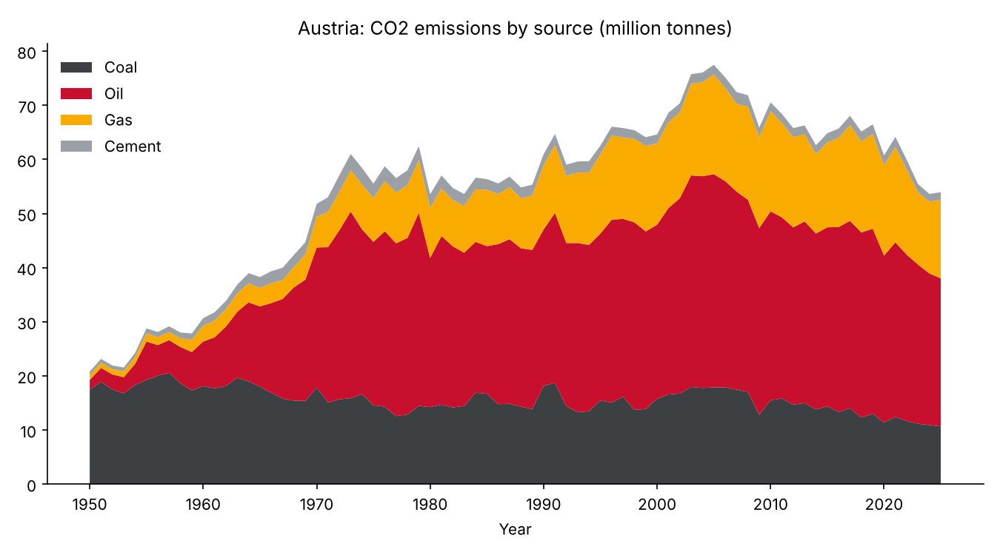

# Austria's CO2 emissions in a regional context

A small, reproducible data-analysis project in **Python and SQL**. It loads the public Our World in Data CO2 dataset into SQLite, answers a few questions with SQL window functions, and fits a regression with plain linear algebra.

**Questions**

1. Where does Austria rank in CO2 per person among its neighbours and peers (Germany, Switzerland, Czechia, Hungary, Italy, Slovenia, Slovakia)?
2. How far has each country come down from its own peak?
3. How does Austria compare with what its income level would predict?

## Key findings

All numbers are produced by `src/analysis.py` and saved in `results/report.md`.

- **Rank, 2025:** Austria emits 6.05 t CO2 per person, third highest of the 8 countries (Czechia 7.35, Germany 6.82; Switzerland lowest with 3.47).
- **Since the peak:** Austria peaked in 2005 at 9.58 t per person and is down 36.8 % since. That is the smallest reduction in the group. Czechia (-60.0 %), Slovakia (-58.1 %) and Germany (-52.9 %) peaked around 1978 and have fallen much further, partly from a much higher starting point.
- **Biggest annual drops since 1990:** 1992 (-8.65 %), 2020 (-8.55 %, the Covid year) and 2009 (-8.40 %, the financial crisis).
- **Income model, 2022:** a least-squares fit `co2_per_capita = a + b * ln(gdp_per_capita)` over 153 countries with more than 1 million people gives a = -22.99, b = 2.97, R2 = 0.45. Austria's actual 6.75 t is below the 8.77 t the model predicts for its GDP per person. With R2 = 0.45 the model is a rough benchmark, not an explanation.

| Rolling per-capita emissions | GDP vs CO2 |
|---|---|
|  |  |



## Method

| Step | Tool |
|---|---|
| Download CSV (about 15 MB, 56k rows) | `src/download_data.py` |
| Load into SQLite, index on (country, year) | `pandas.to_sql` |
| Ranking, year-over-year change, peak detection, rolling mean | SQL: `RANK()`, `LAG()`, `ROW_NUMBER() OVER (PARTITION BY ...)`, `AVG() OVER (... ROWS BETWEEN 4 PRECEDING ...)`, CTEs, joins (`sql/queries.sql`) |
| Regression | Normal equations `(X^T X) beta = X^T y` solved with `numpy.linalg.solve` |
| Charts | matplotlib |

The regression is written out by hand on purpose: it is the same linear algebra used in the first-year Mathematical Foundations of Data Science courses, and a unit test checks that it recovers known coefficients.

## Run it

```bash
python -m venv .venv && source .venv/bin/activate
pip install -r requirements.txt
python src/download_data.py
python src/analysis.py
pytest
```

## Project layout

```
sql/queries.sql        all SQL, one named block per query
src/download_data.py   fetches the dataset
src/analysis.py        loads SQLite, runs queries, makes charts and report
tests/                 unit tests
results/               generated charts, CSV tables and report.md
```

## Limitations

- Territorial (production-based) CO2 only; imported emissions are not counted. Countries that import more goods look cleaner than their consumption warrants.
- GDP data in the dataset ends in 2022, so the regression uses 2022 while the ranking uses the latest year with emissions data (2025).
- The peer group is a judgement call (neighbours plus Italy and Slovenia), not a statistical selection.
- The log-linear model uses one explanatory variable; energy mix, climate and industry structure are ignored.

## Data and licence

Data: [Our World in Data CO2 dataset](https://github.com/owid/co2-data), CC BY 4.0, based on the Global Carbon Project. Code: MIT.
